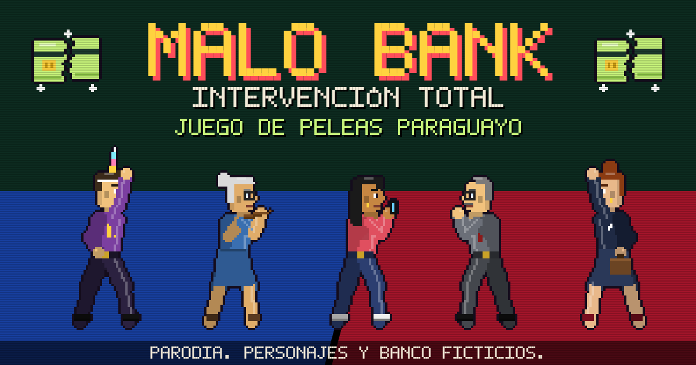

# Malo Bank: Intervención Total

Juego de peleas arcade 2D en pixel art, hecho en Paraguay. Gratuito, de humor, sin fines de lucro y de código abierto.

> **Parodia.** Todos los personajes, el banco "Malo Bank", los Ups, los niveles y los cupones son ficticios. Son caricaturas de situaciones generales, no retratos de personas. No tiene relación, patrocinio ni aval de ninguna entidad, empresa o persona real.



## Jugar

**Celular:** tocá la pantalla (mejor en horizontal). Es una PWA: desde el menú "Instalar app" queda en tu pantalla de inicio y funciona sin internet.

**PC:**

| Acción | Tecla |
|---|---|
| Moverse | A / D o flechas |
| Saltar | W, flecha arriba o espacio |
| Agacharse | S o flecha abajo |
| Golpe / Patada | J / K |
| Especial / Súper | L / I |
| Pausa | Esc o P |

**2 jugadores:** jugador 1 con A, D, W, S y F, G, H, T. Jugador 2 con flechas, coma, punto, la tecla a la derecha del punto y Shift derecho. También funciona con mandos.

## Qué tiene

- 5 personajes, 4 escenarios de Asunción y alrededores, música chiptune propia.
- Modos Arcade, Versus, 2 jugadores y demo automático.
- Agacharse, barridas, combos encadenados, correr, esquivar, derribos.
- "Mi cuenta Malo": Ups, niveles, cupones y reintegros (sujetos a aprobación).

## Cómo correrlo

Es un sitio estático sin dependencias ni build: un solo `index.html` con HTML, CSS y JavaScript.

```bash
# cualquier servidor estático sirve
npx serve .
# o
python3 -m http.server 8080
```

Para publicar en Vercel: importá el repositorio, Framework Preset **Other**, sin comando de build.

Si publicás en otro dominio, actualizá las URLs de `og:image`, `og:url` y `twitter:image` en `index.html`.

## Analíticas

Usa [Vercel Web Analytics](https://vercel.com/docs/analytics): cuenta visitas sin cookies ni datos personales. Fuera de Vercel el script simplemente no carga.

## Estructura

```
index.html            el juego completo
og.png                imagen de vista previa al compartir
icon-*.png, favicon   íconos de la app
manifest.webmanifest  instalación como app (PWA)
sw.js                 service worker: modo sin internet
vercel.json           configuración de Vercel
```

Dentro de `index.html`, el código está separado por secciones comentadas: entrada, personajes y ataques, IA, partida, sprites, escenarios, música, HUD, interfaz y Mi cuenta Malo.

## Colaborar

¡Bienvenido! Leé [CONTRIBUTING.md](CONTRIBUTING.md) antes de mandar cambios. La regla principal: **nada de personas reales**.

## Licencia

Código y recursos bajo [licencia MIT](LICENSE). Tipografías Press Start 2P y Pixelify Sans bajo SIL Open Font License, cargadas desde Google Fonts.

## Contacto

Pedidos de corrección o consultas: **bankmalo12@gmail.com**. Respondemos de buena fe.
